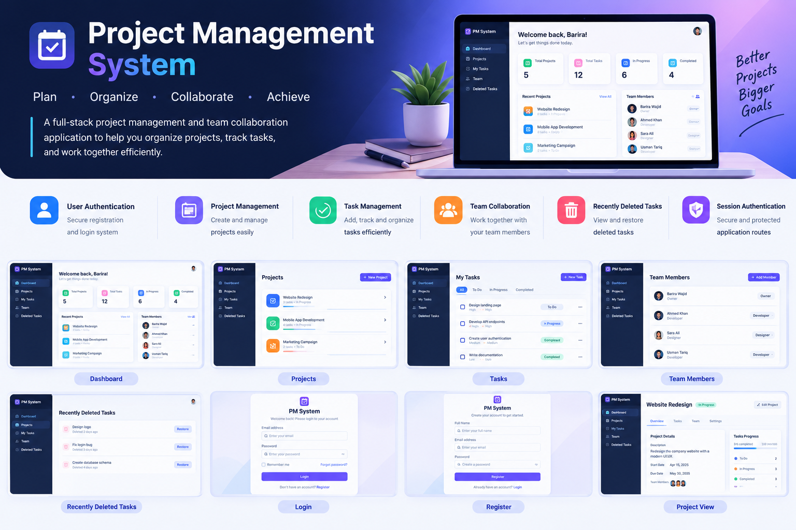
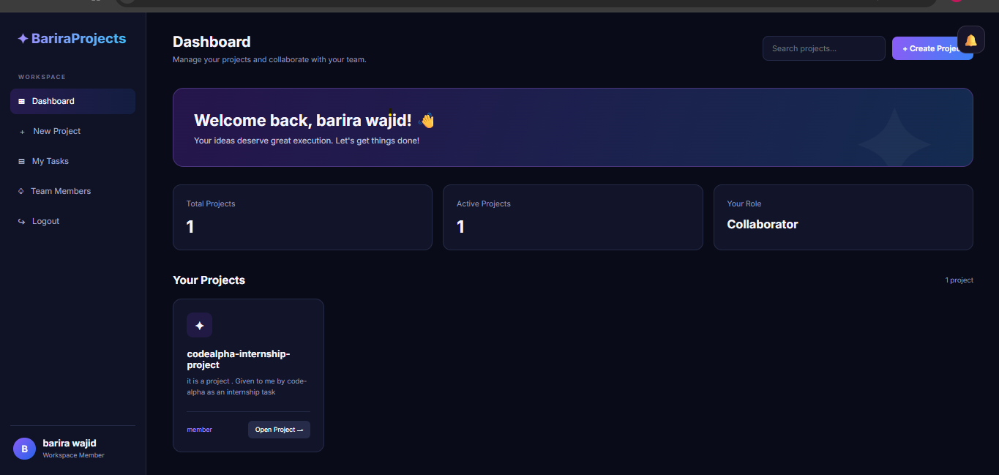
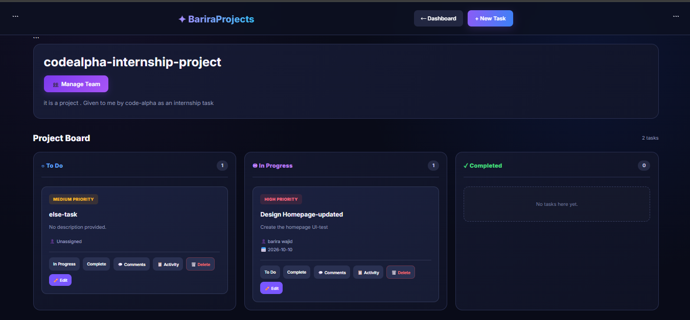
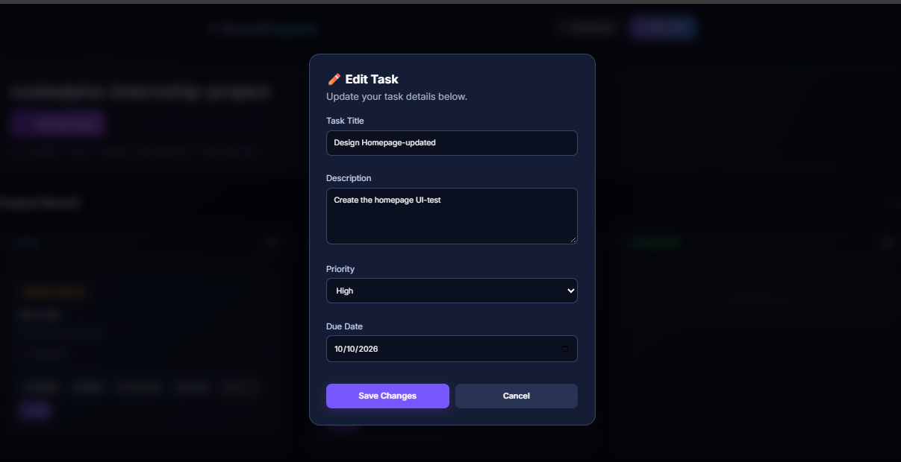
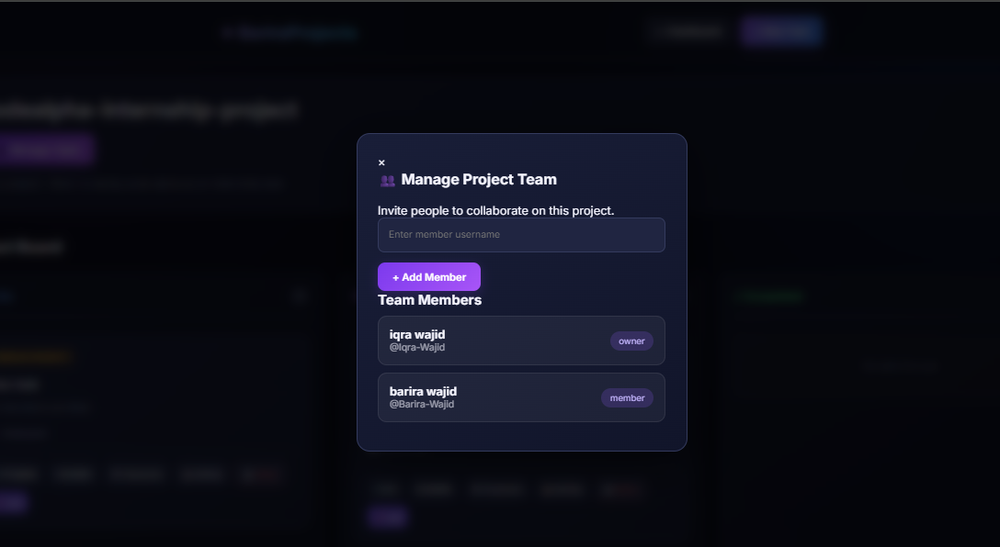
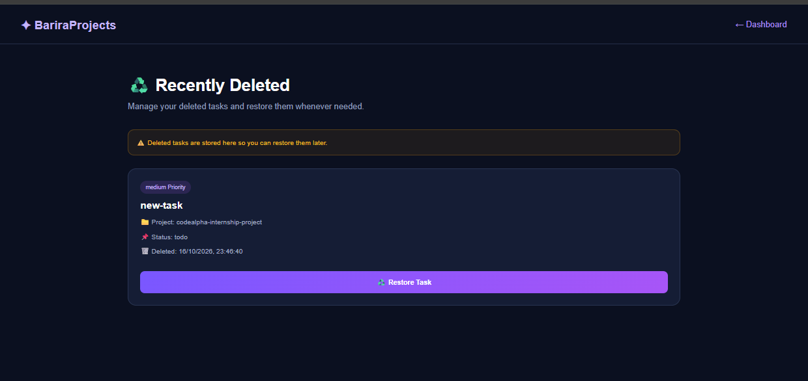

<p align="center">
  
</p>
<h1 align="center">🚀 Project Management System</h1>

<p align="center">
  
</p>

<p align="center">
  <strong>A Full-Stack Project Management & Team Collaboration Application</strong>
</p>

<p align="center">
  
  
  
</p>

---

## 🌟 About The Project

The **Project Management System** is a full-stack web application designed to simplify project organization, task tracking, and team collaboration.

It provides users with an organized workspace where they can create projects, manage tasks, collaborate with team members, and track their work.

One of its useful features is the **Recently Deleted Tasks** section, which allows users to restore deleted tasks instead of losing them permanently.

The application combines a responsive frontend, Node.js backend, and MySQL database to provide a practical project management experience.

---

## ✨ Key Features

### 🔐 Authentication & Security

* User Registration
* User Login
* Session-Based Authentication
* Protected Application Routes

### 📊 Project Management

* Project Management Dashboard
* Create New Projects
* View and Manage Projects
* Organized Project Workspace

### ✅ Task Management

* Create Tasks
* Manage Existing Tasks
* Organize Project Tasks
* Track Task Progress

### 👥 Team Collaboration

* Team Management
* Manage Team Members
* Collaborate on Projects
* Team-Based Task Organization

### 🗑️ Recently Deleted Tasks

* View Recently Deleted Tasks
* Restore Deleted Tasks
* Recover Tasks Without Recreating Them

---

## 📸 Project Screenshots

*Screenshots of the application's interface will be displayed here.*

---

## 💻 Technologies Used

<p align="center">
  
  
  
  
  
  
</p>

### Frontend

* HTML5
* CSS3
* JavaScript

### Backend

* Node.js
* Express.js

### Database

* MySQL

### Development Tools

* Visual Studio Code
* XAMPP
* Git
* GitHub

---

## 🗄️ Database

The application uses **MySQL** for storing and managing project information.

Database operations include:

* User Information
* Project Records
* Task Records
* Team Collaboration Data

Database connection and configuration are managed through `db.js`.

---

## 📂 Project Structure

```text
project-management-task/
│
├── auth.js
├── db.js
├── server.js
├── package.json
├── package-lock.json
│
├── index.html
├── login.html
├── register.html
├── dashboard.html
├── project.html
├── my-tasks.html
├── recently-deleted.html
│
├── .gitignore
└── README.md
```

---

## ⚙️ Installation & Setup

Follow these steps to run the project locally.

### 1. Clone the Repository

```bash
git clone https://github.com/Barira-Wajid/project-management-task.git
```

### 2. Open the Project Folder

```bash
cd project-management-task
```

### 3. Install Dependencies

```bash
npm install
```

### 4. Configure MySQL Database

* Start MySQL using XAMPP.
* Create the database required by the application.
* Configure your database connection in `db.js`.
* Make sure all required tables are created.

### 5. Start the Server

```bash
node server.js
```

### 6. Open the Application

Open the local address displayed in your terminal in your web browser.

---

## 🎯 Project Goals

The main objectives of this project are:

* Simplify project organization.
* Improve task management.
* Support team collaboration.
* Provide an organized project dashboard.
* Allow users to recover recently deleted tasks.
* Practice full-stack web development.

---

## 🚀 Future Improvements

* Real-time team notifications
* Task deadline reminders
* Advanced project analytics
* File attachments for tasks
* Enhanced team communication
* More dashboard customization

---

## 👩‍💻 Developer

<h2 align="center">Barira Wajid</h2>

<p align="center">
  Full-Stack Web Developer | Creative Designer
</p>

<p align="center">
  <a href="https://github.com/Barira-Wajid">
    
  </a>
  <a href="https://www.linkedin.com/in/%20barira-wajid-554701425">
    
  </a>
  <a href="https://bariraportfolio.rf.gd/">
    
  </a>
</p>

---
## 📸 Project Screenshots

### 1. Dashboard



### 2. Projects Management



### 3. Task Management



### 4. Team Management



### 5. Deleted Tasks & Restore


 ---
<p align="center">
  <strong>💜 Dream it. Build it. Improve it.</strong>
  <br><br>
  Made with ❤️ by Barira Wajid
  <br><br>
  ⭐ If you like this project, consider giving it a star!
</p>
